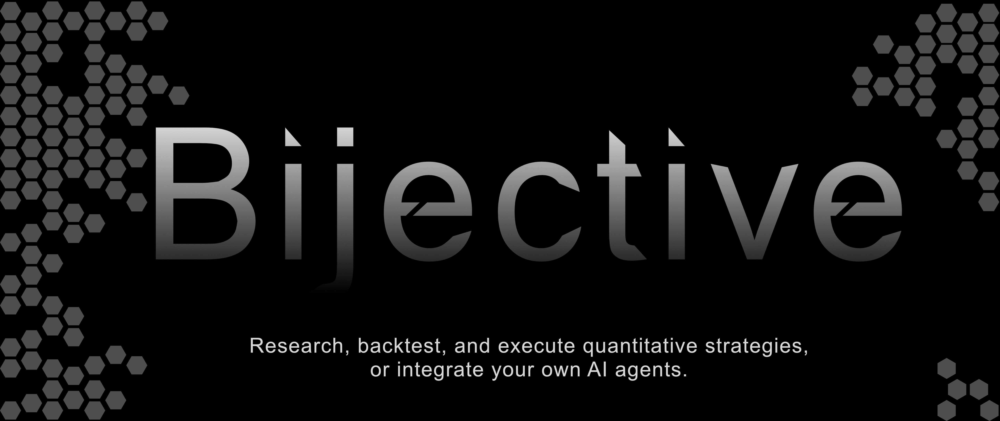

  

<em>You bring the strategy. We build everything it runs on.</em>

## About Bijective Labs

Bijective Labs builds open-source trading software across markets and asset classes, for traders
and firms that trade with their own strategies. Our platform uses a venue-independent market, risk
and execution model. The idea is simple. You spend your time on your edge, and rely on the
software underneath it.

We start from research, not code. An idea stays a hypothesis until the evidence says otherwise,
and every significant decision is written down, with its alternatives, before anything is built.

What we build is self-hosted: it runs on your infrastructure, not ours.

## Our vision

To be the open-source platform traders and firms use to operate across markets and asset classes.

## Our mission

To give every trader and firm operational confidence: software designed to reduce
operational risk, detect problems early, contain failures and support recovery, kept current
through updates and backed by support.

That describes how we engineer, not an outcome we promise. We do not control markets, exchanges or
strategies, and we do not guarantee results.

## What we hold to

- **Honest by default.** We say what the software does, what it does not do, and when we do not know.
- **Your edge stays yours.** Your strategy, keys and data stay under your control.
- **Simple is a feature.** Every step we remove gives time back to you.
- **Depth before breadth.** We support fewer venues and stand behind the quality of each one.

## What we build

**Bijective Platform** 
The self-hosted operating platform for multi-market, multi-asset trading: market data, execution,
risk, portfolio control and an operator console in one system. The venue and adapter model is
separate from the core, so support can extend across asset classes as integrations mature. Its
core will be open source. In active development, with early access by invitation. 
[bijectivelabs.dev/bijective](https://www.bijectivelabs.dev/bijective)

**TRA** 
Open-source autonomous trading agents for supported markets. Language models propose a trade;
fixed, tested rules compute every figure, size the position and decide whether an order goes out.
MIT license.
`pip install bitra`, then `tra`. 
[github.com/BijectiveLabs/bitra](https://github.com/BijectiveLabs/bitra)

**Research** 
Strategy studies, market findings and failure analysis from our research work, published for
education. 
[bijectivelabs.dev/insights](https://www.bijectivelabs.dev/insights)

## Links

- Website: [bijectivelabs.dev](https://www.bijectivelabs.dev)
- About: [bijectivelabs.dev/about](https://www.bijectivelabs.dev/about)
- Docs: [docs.bijectivelabs.dev](https://docs.bijectivelabs.dev)
- Contact: [bijectivelabs.dev/contact](https://www.bijectivelabs.dev/contact)
